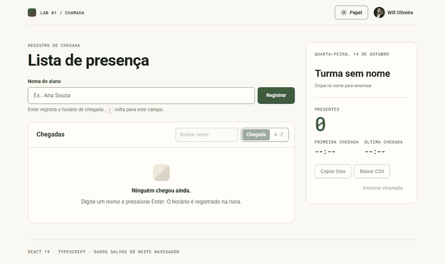

<p align="center">
  <a href="https://will-ifes.github.io/reactapp/">
    
  </a>
</p>

# Lista de presença · React

Uma chamada de turma que registra o horário de chegada de cada aluno, recusa nomes repetidos e exporta a lista. Começou como estudo de React, Vite, props, estado e efeitos. Na revisão virou um app em TypeScript, com testes, acessibilidade conferida e a linguagem visual do [Will Labs](https://github.com/Will-Ifes/will-labs).

**React 19 · TypeScript · Vite 8 · Vitest** · [Ver online](https://will-ifes.github.io/reactapp/)

<p align="center">
  <a href="https://will-ifes.github.io/reactapp/">
    
  </a>
  <br />
  <sub>Clique na demonstração para abrir a página publicada.</sub>
</p>

## O que dá para fazer

- Digite o nome e pressione **Enter**: o horário entra na hora e o campo fica pronto para o próximo nome.
- Nome repetido é recusado, sem diferenciar acento nem maiúscula (`José Lima` e `jose lima`), e a mensagem diz desde quando a pessoa já está na lista.
- Remova alguém por engano e clique em **Desfazer**: a pessoa volta para a posição original de chegada.
- Busque na lista sem acento, ordene por chegada ou de A a Z e veja há quanto tempo cada um chegou.
- Renomeie a turma clicando no título do painel. O painel também mostra presentes, primeira e última chegada.
- **Copiar lista** gera um texto para colar no chat; **Baixar CSV** gera uma planilha que o Excel em português abre direto.
- Tema **Papel** (claro) ou **Floresta** (escuro), seguindo o sistema na primeira visita. A tecla <kbd>/</kbd> volta para o campo de nome.

Tudo fica salvo só neste navegador. Nenhum dado sai da página.

## Design

A interface usa os fundamentos do Will Labs como referência, adaptados a um app de uma tela:

| Fundamento | Como aparece aqui |
| --- | --- |
| Temas `paper` e `forest` | Mesmos valores de `packages/tokens/themes.json`, trocados por `data-tema` no `<html>` |
| Escala de 4 px e raios 8/16 | Tokens `--wl-space-*`, controles com raio 8 e superfícies com raio 16 |
| Roboto + Roboto Mono | Mono em rótulos curtos, horários e números do painel |
| Divisão diagonal | Selo da marca e avatares com iniciais, com o ângulo variando por nome |
| Controles de 40 px (44 px no toque) | `--wl-control` com `@media (pointer: coarse)` |
| Toast de até 300 px | Aviso curto com ação de desfazer, anunciado ao leitor de tela |

## O que mudou na revisão

| Antes | Depois |
| --- | --- |
| React 18, Vite 3 e JavaScript, com 12 vulnerabilidades no `npm audit` (1 crítica) | React 19, Vite 8 e TypeScript `strict`, com 0 vulnerabilidades |
| `key` do card era o horário em segundos: dois alunos no mesmo segundo colidiam | `id` com `crypto.randomUUID()` |
| Aceitava nome vazio e repetido, não limpava o campo e só adicionava pelo clique | Enter, nome normalizado, erros ligados ao campo por `aria-describedby` e foco devolvido |
| Cards roxos de 50% da largura, sem rótulo no campo | Layout em duas colunas que vira uma no celular, com rótulos, contraste AA e dois temas |
| Lista perdida ao recarregar | Turma e presenças salvas, com leitura tolerante a dados corrompidos e ao formato antigo |
| Cabeçalho vazio se a API do GitHub falhasse | Estados de carregando e erro, com a requisição cancelada ao desmontar |
| Sem testes nem lint | 15 testes com Vitest e Testing Library, ESLint e typecheck no CI |

**Validação:** axe-core sem violações nos dois temas em 375, 768 e 1366 px, com a lista preenchida e uma mensagem de erro visível.

## Por dentro do código

| Código | Responsabilidade |
| --- | --- |
| [`src/pages/Home/index.tsx`](src/pages/Home/index.tsx) | Orquestra a página: atalho `/`, avisos, desfazer e exportação. |
| [`src/hooks/usePresencas.ts`](src/hooks/usePresencas.ts) | Lista, turma, regra de nome repetido e persistência. |
| [`src/hooks/useTema.ts`](src/hooks/useTema.ts) | Tema claro/escuro com preferência do sistema e memória da escolha. |
| [`src/components/`](src/components) | Cabeçalho, formulário, lista, item, painel da turma, avatar e toast, cada um com seu CSS. |
| [`src/styles/tokens.css`](src/styles/tokens.css) | Tokens de cor, espaço, raio e tipografia baseados no Will Labs. |
| [`src/utils/formatar.ts`](src/utils/formatar.ts) | Horários, tempo relativo, iniciais, busca sem acento, texto e CSV. |

## Executar localmente

Requer Node.js 20.19 ou superior.

```bash
git clone https://github.com/Will-Ifes/reactapp.git
cd reactapp
npm install
npm run dev
```

| Comando | O que faz |
| --- | --- |
| `npm run dev` | Servidor de desenvolvimento |
| `npm test` | Testes com Vitest |
| `npm run lint` | ESLint |
| `npm run typecheck` | Checagem do TypeScript |
| `npm run build` | Typecheck e build de produção |

O deploy no GitHub Pages é feito pelo workflow [`deploy.yml`](.github/workflows/deploy.yml), que roda lint, testes e build antes de publicar.

---

Mantido por **Will Oliveira** · [Perfil](https://github.com/Will-Ifes) · [LinkedIn](https://www.linkedin.com/in/wildemberg-de-jesus-oliveira/)
