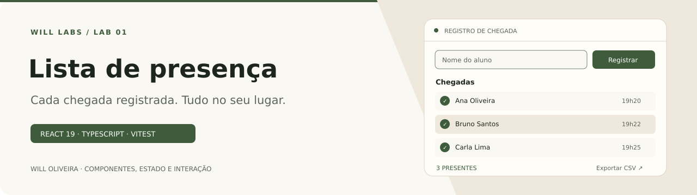

<p align="center">
  
</p>

# Lista de presença · React

Registro de nomes e horários com perfil consultado na API do GitHub.

Estudo de React 18, Vite, props, estado e efeitos.

## Explore o diferencial

| Ponto de entrada | O que observar |
| --- | --- |
| [Do formulário à lista](src/pages/Home/index.jsx) | O estado da página alimenta os registros e os horários exibidos. |
| [Componente reutilizável](src/components/Card/index.jsx) | Cada registro é apresentado por um cartão separado da lógica da página. |

## Destaques

- Inclusão de nomes com horário de registro.
- Cartões renderizados a partir do estado.
- Consulta de nome e avatar do GitHub.

<details>
<summary><strong>Organização e código</strong></summary>

### Por dentro do código

| Código | O que observar |
| --- | --- |
| [`src/pages/Home/index.jsx`](src/pages/Home/index.jsx) | Estado e carregamento de perfil. |
| [`src/components/Card/index.jsx`](src/components/Card/index.jsx) | Apresentação dos registros. |

</details>

<details>
<summary><strong>Executar e consultar</strong></summary>

### Executar localmente

Requer Node.js e npm compatíveis com as dependências versionadas.

```bash
git clone https://github.com/Will-Ifes/reactapp.git
cd reactapp
npm install
npm run dev
```

Abra o endereço informado pelo servidor no terminal.

### Comandos disponíveis

| Comando | Script versionado |
| --- | --- |
| `npm run dev` | `vite` |
| `npm run build` | `vite build` |
| `npm run preview` | `vite preview` |

</details>

<details>
<summary>Escopo e referências</summary>

Os registros ficam em memória.

</details>

---

Mantido por **Will Oliveira** · [Perfil](https://github.com/Will-Ifes) · [LinkedIn](https://www.linkedin.com/in/wildemberg-de-jesus-oliveira/)
